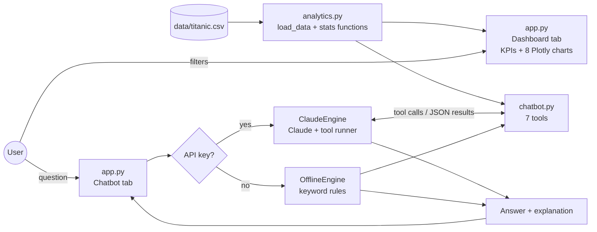
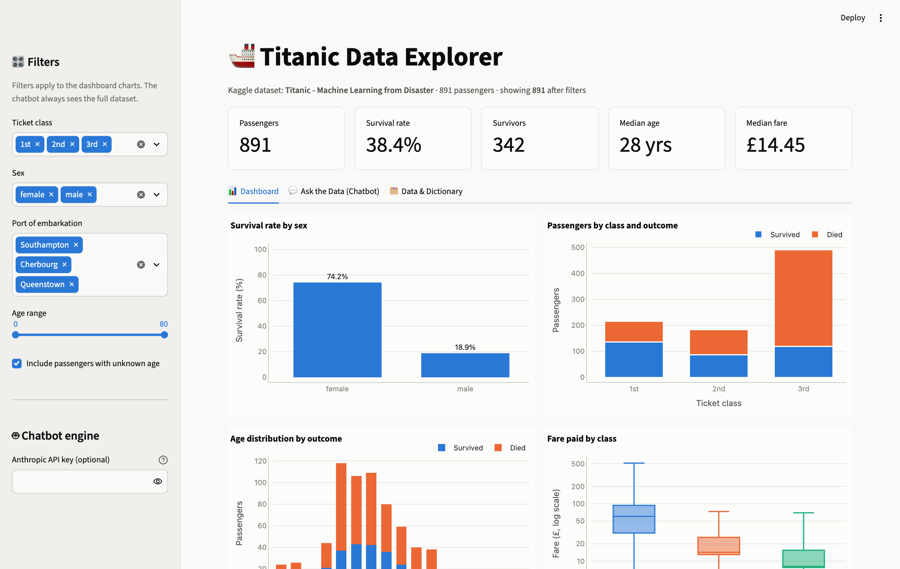
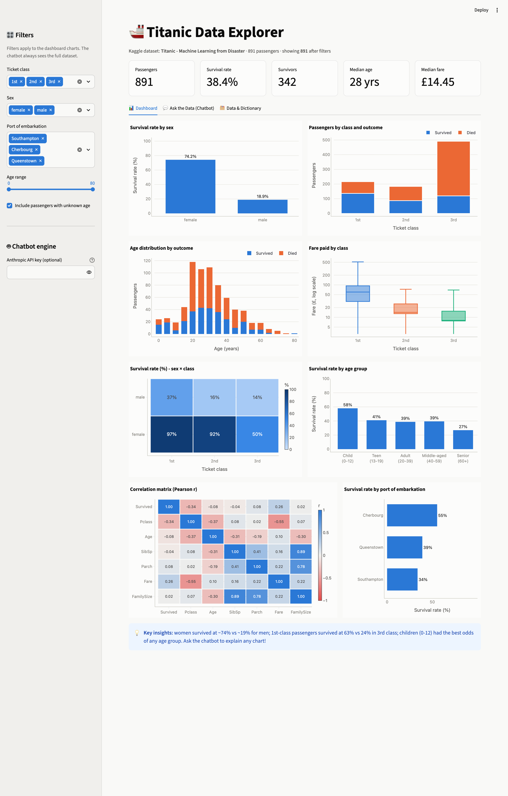
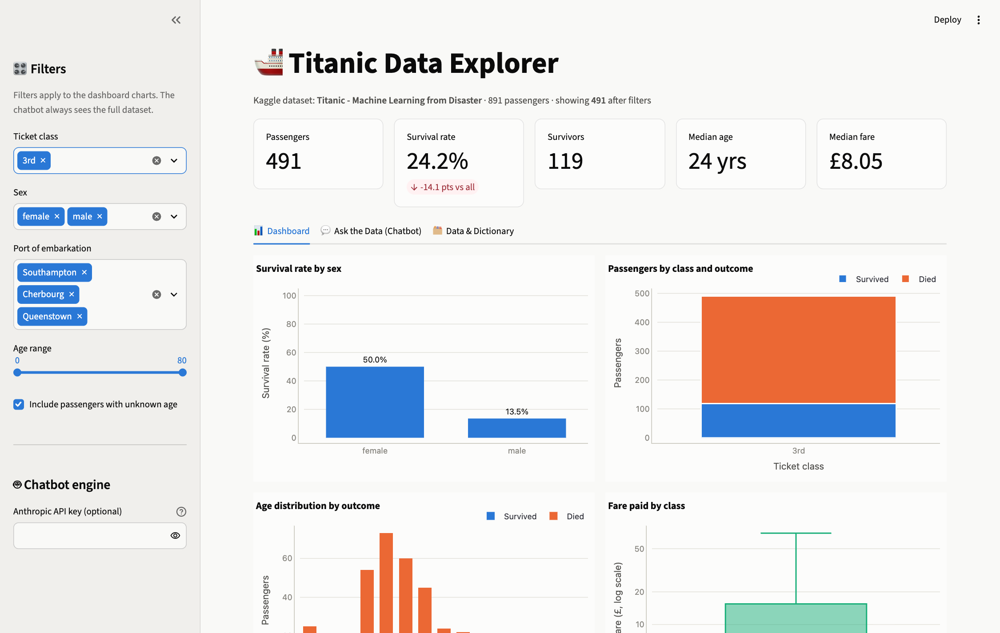
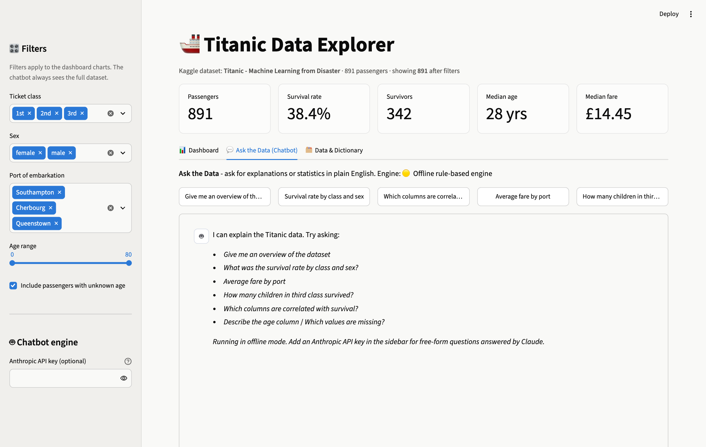
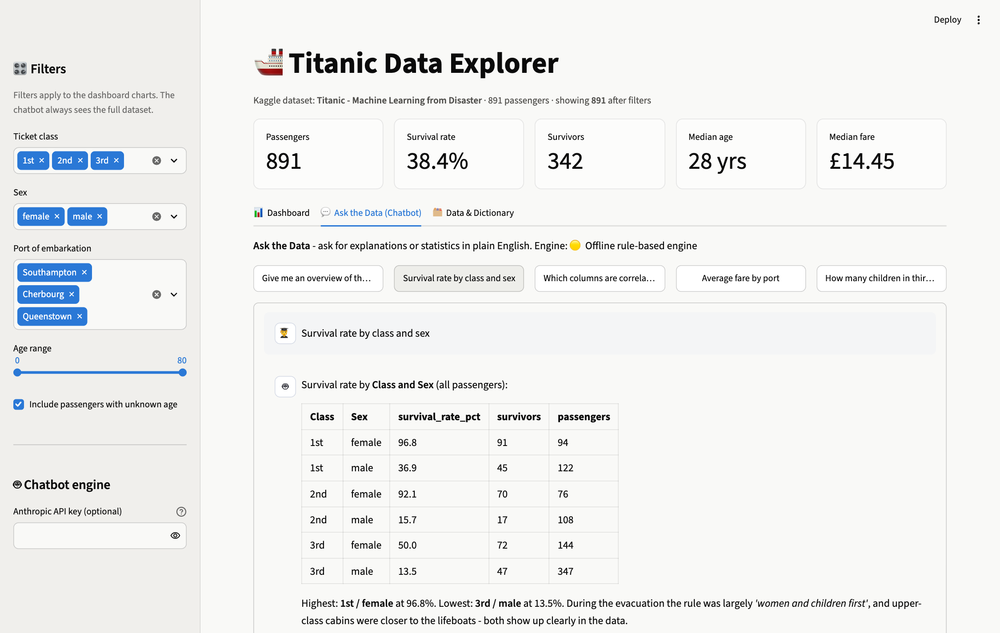
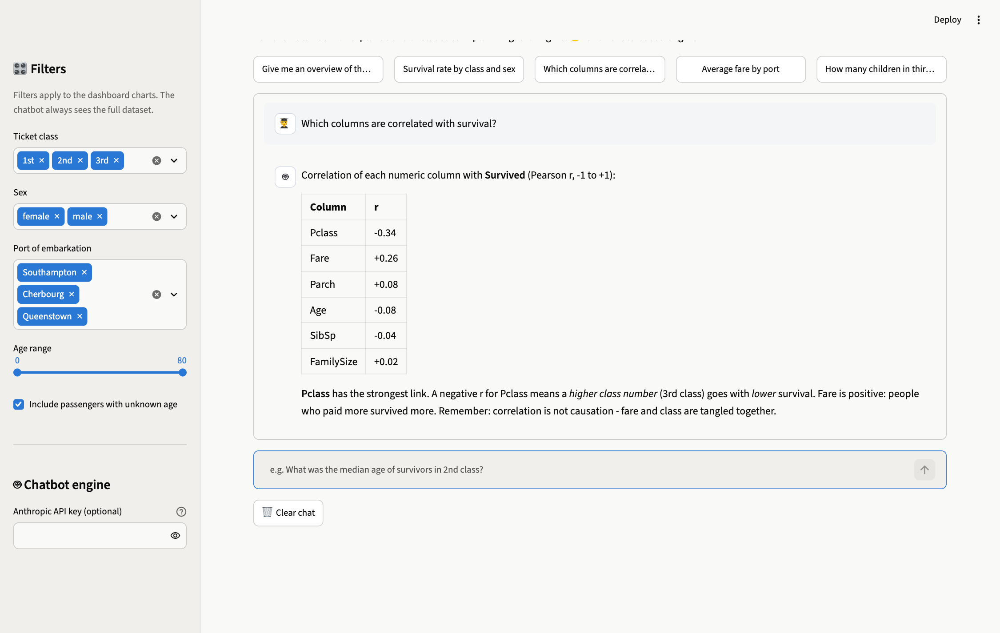
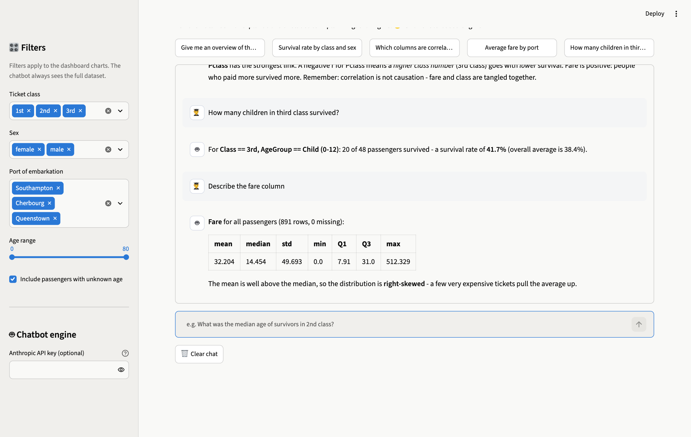
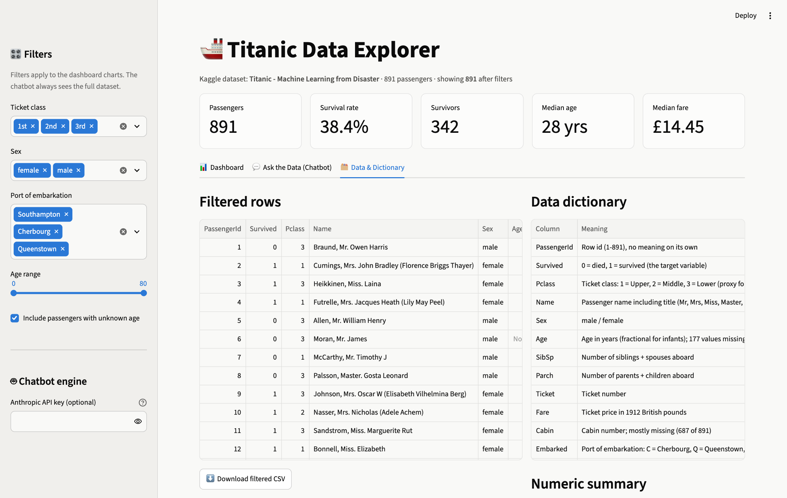

# Titanic Data Explorer - Project Documentation

**An interactive dashboard with a data-explaining chatbot, built on a Kaggle dataset**

---

## 1. Objective

Build a web dashboard that lets a user explore a real Kaggle dataset visually and ask questions
about it in plain English. The chatbot should:

1. answer **statistical** questions (rates, averages, counts, correlations) with correct numbers, and
2. **explain** what those numbers mean, the way a tutor would.

## 2. Dataset

| | |
|---|---|
| **Name** | Titanic - Machine Learning from Disaster |
| **Source** | Kaggle, <https://www.kaggle.com/c/titanic/data> (`train.csv`) |
| **Size** | 891 rows (passengers) × 12 columns |
| **Target** | `Survived` (0 = died, 1 = survived) |
| **Why this dataset** | Well known, small, a mix of numeric and categorical columns, real missing values, and a clear story to explain |

### Columns

| Column | Meaning | Type | Missing |
|---|---|---|---|
| PassengerId | Row id | int | 0 |
| Survived | 0 = died, 1 = survived | binary | 0 |
| Pclass | Ticket class 1/2/3 (proxy for wealth) | ordinal | 0 |
| Name | Full name with title | text | 0 |
| Sex | male / female | categorical | 0 |
| Age | Age in years | numeric | **177** |
| SibSp | # siblings/spouses aboard | int | 0 |
| Parch | # parents/children aboard | int | 0 |
| Ticket | Ticket number | text | 0 |
| Fare | Ticket price (£, 1912) | numeric | 0 |
| Cabin | Cabin number | text | **687** |
| Embarked | Port: C = Cherbourg, Q = Queenstown, S = Southampton | categorical | **2** |

### Derived columns (feature engineering)

| Column | How it is made | Why |
|---|---|---|
| `AgeGroup` | Age binned into Child 0-12, Teen 13-19, Adult 20-39, Middle-aged 40-59, Senior 60+ | Easier to read than a continuous age |
| `FamilySize` | SibSp + Parch + 1 | One number for "travelling with family" |
| `Title` | Regex on Name (Mr, Mrs, Miss, Master, Rare) | Encodes sex, age and status together |
| `Class` | Pclass → "1st/2nd/3rd" | Readable labels |
| `Port` | Embarked → full port name | Readable labels |

## 3. Technology

| Layer | Tool | Reason |
|---|---|---|
| Language | Python 3 | Standard for data science |
| Data | pandas | Grouping, aggregation, correlation |
| Web UI | Streamlit | A full web app in pure Python |
| Charts | Plotly | Interactive hover tooltips, zoom, PNG export |
| Chatbot (AI mode) | Anthropic Claude API (`claude-opus-5-5`) with **tool use** | Understands free-form questions; calls our functions for the numbers |
| Chatbot (offline mode) | Rule-based Python | Works without a key or internet |
| Screenshots | Playwright | Automated, reproducible captures |

## 4. Architecture



The design rule is that **all statistics live in `analytics.py`**. The charts, the Claude tools and
the offline engine all call the same functions, so the chatbot can never contradict the dashboard.

### Project structure

```
ananya/
├── app.py                    # Streamlit UI
├── analytics.py              # data loading, derived columns, statistics
├── chatbot.py                # ClaudeEngine, OfflineEngine, get_engine()
├── data/titanic.csv          # Kaggle train.csv
├── screenshots/              # images used in this document
├── scripts/take_screenshots.py
├── .streamlit/config.toml    # theme
├── requirements.txt
├── README.md                 # setup, run, deploy
├── DOCUMENTATION.md          # this report
└── PROMPTS.md                # build prompts + chatbot prompts
```

## 5. How the chatbot works

### 5.1 AI mode: Claude with tool calling

A language model on its own may "remember" Titanic facts and get them slightly wrong. To keep the
answers correct, the model **does not do the maths**. Instead:

1. The user's question and a **system prompt** (see `PROMPTS.md`) are sent to Claude together
   with descriptions of 7 **tools**:

   | Tool | Answers questions like |
   |---|---|
   | `dataset_overview` | "What is this dataset?" |
   | `describe_column` | "Describe the Age column" |
   | `survival_rate_by` | "Survival by class and sex" |
   | `group_stats` | "Average fare by port" |
   | `correlation` | "What is correlated with survival?" |
   | `count_rows` | "How many children in 3rd class survived?" |
   | `sample_rows` | "Who paid the highest fares?" |

2. Claude chooses a tool and its arguments, e.g.
   `survival_rate_by(group_by=["Class","Sex"])`.
3. Our Python code runs the pandas function and returns JSON.
4. Claude reads the real numbers and writes the explanation. It can call several tools in a row
   for multi-part questions.

The SDK's **tool runner** (`client.beta.messages.tool_runner`) handles this loop. Filters are passed
as structured `{column, op, value}` objects, never as code, so user text is never executed.

Other settings:
* `effort: "low"` - chat answers don't need deep reasoning, so they come back faster and cheaper.
* Server-side `fallbacks: "default"` - if the main model declines a request, the API retries it on a
  fallback model. A final `refusal` is caught and turned into a polite message.
* If the API call fails (no internet, bad key), the app shows a warning and answers with the offline engine.

### 5.2 Offline mode: rule-based engine

With no API key, `OfflineEngine` parses the question with keyword rules:

| Detects | Example words | Action |
|---|---|---|
| Intent | overview, missing, correlation, survival, average/median/max, how many | Picks the analytics function |
| Group-by columns | "by class and sex", "per port" | Collects columns after the word "by" |
| Filters | women, third class, children, older than 50, Cherbourg | Builds `{column, op, value}` filters |
| Metric | age, fare, family size | Column to aggregate |

It answers with a markdown table plus a short written explanation (e.g. "the mean is well above the
median, so the distribution is right-skewed").

## 6. Dashboard walkthrough

### 6.1 Overview: KPI cards and the first charts



The sidebar holds the **filters** (class, sex, port, age range, unknown ages) and the optional API
key. The five **KPI cards** update with the filters; when a filter is active, the survival-rate card
shows how far the selection is from the overall 38.4%.

### 6.2 Full dashboard



| Chart | Type | What it shows |
|---|---|---|
| Survival rate by sex | Bar | Women 74.2% vs men 18.9% |
| Passengers by class and outcome | Stacked bar | 3rd class was the largest group and had the most deaths |
| Age distribution by outcome | Stacked histogram | Most passengers were 20-40; young children had better odds |
| Fare paid by class | Box plot (log scale) | Median fare £60 (1st) vs £14 (2nd) vs £8 (3rd) |
| Survival rate - sex × class | Heatmap | The two factors together: 97% (1st-class women) down to 14% (3rd-class men) |
| Survival rate by age group | Bar | Children 58% vs seniors 27% |
| Correlation matrix | Diverging heatmap | Pclass (r = -0.34) and Fare (r = +0.26) relate most to survival |
| Survival rate by port | Horizontal bar | Cherbourg 55% vs Southampton 34% |

**Design choices:** colour-blind-safe palette (blue = survived, orange = died, used the same way on
every chart); a one-hue blue scale for magnitudes; a red-grey-blue diverging scale for correlation
(grey = 0); hover tooltips with exact values and sample sizes on every chart.

### 6.3 Filters in action (3rd class only)



With only 3rd class selected, survival drops to **24.2%** (-14.1 points vs. all passengers), and
even women in 3rd class survived at only 50%.

### 6.4 Chatbot

**Welcome screen** - shows which engine is active, five suggested questions, and the chat history:



**Grouped statistics** - "Survival rate by class and sex":



**Explaining relationships** - "Which columns are correlated with survival?":



**Counting with filters and describing a column** - "How many children in third class survived?" and
"Describe the fare column":



*(The screenshots show offline mode. With an API key, the same tab answers through Claude, with
longer explanations and support for free-form questions.)*

### 6.5 Data & dictionary



The filtered raw rows (downloadable as CSV), the data dictionary including the derived columns, and
a numeric summary (`describe()`).

## 7. Key findings

| # | Finding | Evidence |
|---|---|---|
| 1 | **Sex was the strongest factor.** 74.2% of women survived vs 18.9% of men. | Survival-by-sex chart |
| 2 | **Class mattered a lot.** 63.0% (1st) → 47.3% (2nd) → 24.2% (3rd). | Class chart, heatmap |
| 3 | **Sex and class combine.** 96.8% of 1st-class women survived; 13.5% of 3rd-class men. | Sex × class heatmap |
| 4 | **"Children first" shows in the data.** Children 0-12 survived at 58.0%; boys titled "Master" at 57.5% vs 15.7% for "Mr". | Age-group chart, Title stats |
| 5 | **Small families did best.** Families of 2-4 survived at 55-72%; people travelling alone at 30.4%; families of 5+ at 0-33%. | `survival_rate_by(["FamilySize"])` |
| 6 | **Cherbourg passengers survived more (55.4%)**, mostly because more of them were in 1st class (mean fare ≈ £60 vs £27 at Southampton). The port itself didn't cause it. | Port chart + "average fare by port" |
| 7 | **Fare and class overlap** (r = -0.55 with each other), so their effects can't be separated with simple correlations. | Correlation matrix |

## 8. Testing

| Test | Result |
|---|---|
| Offline engine on 15+ sample questions (see `PROMPTS.md` Part C) | Answers match the dashboard numbers |
| Bugs found in testing and fixed | "by class **and** sex" grouped by class only; "older **than** 50" was ignored; "which **columns** are correlated" went to the overview answer |
| Claude engine request | Checked with an invalid key: the SDK builds and sends the tool-calling request and the API rejects only the key (HTTP 401). A full conversation needs a real key. |
| Dashboard renders with all filters, single class, and an empty selection | Works (empty selection shows a warning) |
| Screenshots | Generated automatically by `scripts/take_screenshots.py` |

## 9. Limitations

* **Age is missing for 19.9%** of passengers. Age charts and statistics use only the rows that have it.
* This is Kaggle's *training* split (891 of the ~2,224 people aboard), so it is a sample, not the full passenger list.
* Correlation ≠ causation. Class, fare, port and cabin location are all tangled together.
* The offline engine only understands phrasings it has rules for; anything else gets a help message.
* Claude mode needs an API key and internet, and each question costs a small amount of API credit.

## 10. Future work

* Add a survival-prediction model (logistic regression / random forest) and let the chatbot explain its feature importances.
* Let the chatbot return charts as well as text.
* Impute missing ages from title and class.
* Make the dashboard work with any CSV the user uploads.

## 11. How to run

See `README.md`. In short:

```bash
pip install -r requirements.txt
streamlit run app.py
```

Hosting: deploy free on **Streamlit Community Cloud** (steps in `README.md`).

## 12. References

* Kaggle - *Titanic: Machine Learning from Disaster*: <https://www.kaggle.com/c/titanic>
* Streamlit documentation: <https://docs.streamlit.io>
* Plotly Python: <https://plotly.com/python/>
* Anthropic - Tool use with Claude: <https://platform.claude.com/docs/en/agents-and-tools/tool-use/overview>
