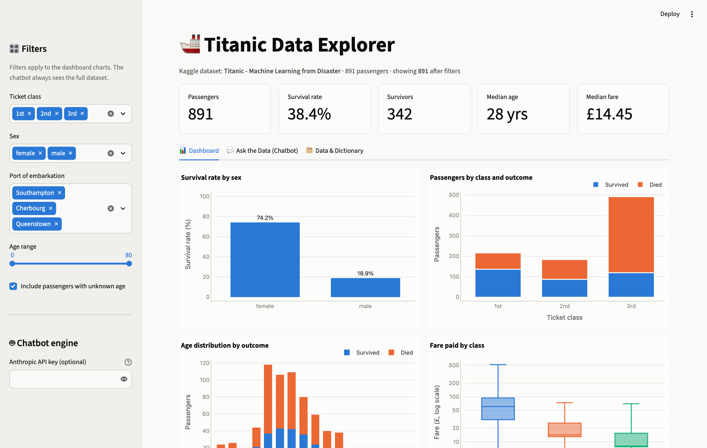

# 🚢 Titanic Data Explorer

An interactive dashboard for the Kaggle **Titanic** dataset, with a built-in **chatbot** that answers
questions about the data in plain English ("What was the survival rate by class and sex?",
"Which columns are correlated with survival?").



| File | What it is |
|---|---|
| `app.py` | Streamlit dashboard (filters, KPI cards, 8 charts, chatbot tab, data tab) |
| `analytics.py` | All statistics, shared by the charts and the chatbot |
| `chatbot.py` | Chatbot: Claude + tool calling, with an offline rule-based fallback |
| `data/titanic.csv` | Kaggle *Titanic - Machine Learning from Disaster* `train.csv` (891 rows) |
| `DOCUMENTATION.md` | Full project report with screenshots |
| `PROMPTS.md` | The prompts used to build the project and the chatbot's own prompts |
| `scripts/take_screenshots.py` | Regenerates everything in `screenshots/` |

## Run it locally

Requires Python 3.10+.

```bash
python3 -m venv .venv
source .venv/bin/activate          # Windows: .venv\Scripts\activate
pip install -r requirements.txt
streamlit run app.py
```

Then open http://localhost:8501.

### Chatbot modes

* **Offline mode (default, free):** a keyword-based engine answers common questions with no
  API key and no internet.
* **Claude mode:** set an Anthropic API key and the bot uses Claude with tool calling, so it can
  answer free-form questions. Either:
  * `export ANTHROPIC_API_KEY=sk-ant-...` before `streamlit run app.py`, or
  * paste the key into the sidebar field (it is only kept for your browser session).

## Getting the data from Kaggle

The CSV is already in `data/`. To download it from Kaggle yourself:

```bash
pip install kaggle                  # put your kaggle.json API token in ~/.kaggle/
kaggle competitions download -c titanic
unzip titanic.zip train.csv && mv train.csv data/titanic.csv
```

Or download `train.csv` from <https://www.kaggle.com/c/titanic/data> in the browser.

## Hosting it online (free)

### Option 1 - Streamlit Community Cloud (recommended)

1. Push this folder to a **public GitHub repo** (`.gitignore` already excludes `.venv` and secrets).
2. Sign in at <https://share.streamlit.io> with GitHub and click **Create app**.
3. Pick the repo, branch `main`, main file `app.py`. Under *Advanced settings* choose Python 3.12.
4. *(Optional, for Claude mode)* In **Advanced settings → Secrets**, paste:
   ```toml
   ANTHROPIC_API_KEY = "sk-ant-..."
   ```
   Streamlit exposes top-level secrets as environment variables, so the app picks it up automatically.
5. Click **Deploy**. You get a public URL like `https://<your-app>.streamlit.app`.

> ⚠️ If you add your API key as a secret, anyone with the link can chat using your credits.
> For a public demo, leave the secret out (offline mode) or let visitors paste their own key in the sidebar.

### Option 2 - Hugging Face Spaces

Create a new Space → SDK **Docker** → template **Streamlit**, upload these files
(keep the template's Dockerfile and point it at `app.py`), and add `ANTHROPIC_API_KEY` under
*Settings → Variables and secrets*.

### Option 3 - Render

New **Web Service** from your GitHub repo, build command `pip install -r requirements.txt`,
start command `streamlit run app.py --server.port $PORT --server.address 0.0.0.0`.
The free tier sleeps when idle, so the first visit takes ~30 s.

## Regenerating screenshots

```bash
pip install -r requirements-dev.txt
playwright install chromium        # or pass --browser /path/to/Chrome
streamlit run app.py --server.port 8599 &
python scripts/take_screenshots.py --url http://localhost:8599
```
